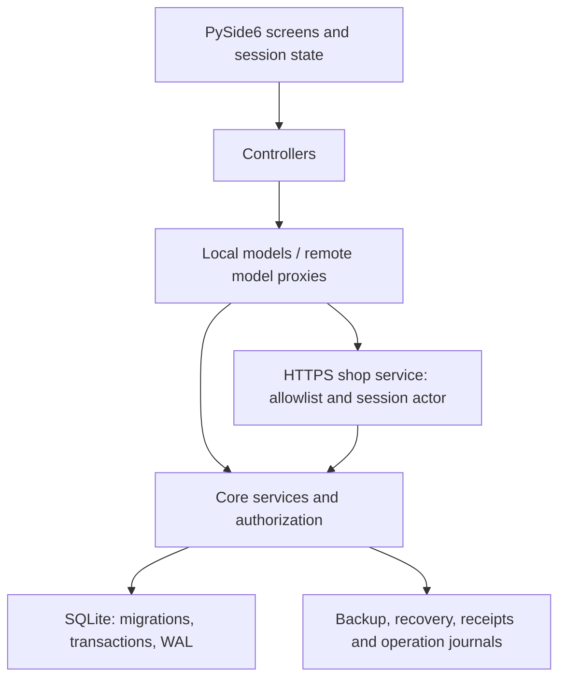

# Architecture audit

Audit evidence collected: 2026-11-10; reports finalized: 2026-11-11. Phase 1: analysis and documentation only.

Baseline: local `ui/reference-replica`, commit `1dd242cebae3ca792750fc8dc91f03b84a7705ec`, matching the GitHub branch at inspection. GitHub `main` was `1fc56654c5a69ae62525a13b17c6235568f6eee6`; findings target the audited branch, not an assertion that main has identical UI. No application code, live database, merge, deployment, or release changes were made.

Evidence labels: **Reproduced** = observed in a disposable database or recorded exact-commit CI; **Source-confirmed** = reachable behavior established by code inspection; **Risk** = plausible consequence requiring a targeted experiment; **Unverified** = missing acceptance evidence. Severity reflects business impact, not exploitability alone. Complexity: S = 1–2 engineering days; M = 3–5; L = 1–2 weeks; XL = multiple weeks. Estimates exclude independent acceptance, regulatory review and rollout; overlapping fixes must not simply be summed.

## Scope and architecture

The tracked inventory spans 194 Python files (AST parsed), 25 migration files, 47 test files, 56 UI files, 43 core files, 15 controllers, 4 models, 35 documentation files, 26 scripts and 8 packaging files. The audit combined inventory, risk-led source tracing, isolated business-rule probes, local pytest execution, and exact-commit GitHub logs. This is not a claim of exhaustive path coverage or manual inspection of every statement. No live pharmacy dataset, printer/scanner hardware, Windows desktop, or sample-UI pixel comparison was available for acceptance testing.

Useful foundations include parameterized database operations, explicit write transactions, FEFO batch allocation, authoritative checkout price/stock validation, persisted checkout identifiers, manager discount approval, role checks, trusted TLS, and a separate active asynchronous UI runner. These reduce risk but do not resolve the defects below. Controllers also depend on UI session state, authorization boundaries vary across services, and recovery spans database and filesystem state.

The immediate release blockers are A01–A04, D01, D02, and the failed CI/Windows acceptance gates in U01/U02. Security deployment risks require explicit threat-model acceptance before any multi-counter pilot.

## A01 — Returns attach to the wrong counter cash shift

- **Severity / impact:** High — corrupts counter reconciliation and refund accountability.
- **Evidence status:** Reproduced
- **Location:** [core/return_service.py:58](https://github.com/aazannoorkhuwaja/Pharma-Khaato/blob/1dd242cebae3ca792750fc8dc91f03b84a7705ec/core/return_service.py#L58); [core/return_service.py:242](https://github.com/aazannoorkhuwaja/Pharma-Khaato/blob/1dd242cebae3ca792750fc8dc91f03b84a7705ec/core/return_service.py#L242); [models/return_model.py:13](https://github.com/aazannoorkhuwaja/Pharma-Khaato/blob/1dd242cebae3ca792750fc8dc91f03b84a7705ec/models/return_model.py#L13).
- **Evidence:** A sale on terminal A was returned through an authenticated terminal-A ShopService session; Customer_Returns.session_id was B (2), rather than A (1). The helper selects the latest open employee shift without terminal identity.
- **Reproduction / verification:** Open A then B shifts for the same employee; sell on A; return on A. See executable disposable probe in EDGE_CASE_TEST_MATRIX.md.
- **Recommended correction:** Carry trusted terminal identity through model/service signatures; require the correct open shift for every cash refund, including credit-payment refunds.
- **Regression tests needed:** Two terminals/same employee; reverse opening order; no A shift; cash/card/credit refund combinations; forged terminal arguments; retry returns.
- **Implementation complexity:** M.

## A02 — MRP can be bypassed after a product-price update

- **Severity / impact:** High — overcharges customers and defeats the batch price ceiling.
- **Evidence status:** Reproduced
- **Location:** [core/inventory_service.py:261](https://github.com/aazannoorkhuwaja/Pharma-Khaato/blob/1dd242cebae3ca792750fc8dc91f03b84a7705ec/core/inventory_service.py#L261); [core/inventory_service.py:361](https://github.com/aazannoorkhuwaja/Pharma-Khaato/blob/1dd242cebae3ca792750fc8dc91f03b84a7705ec/core/inventory_service.py#L361); [core/pos_service.py:147](https://github.com/aazannoorkhuwaja/Pharma-Khaato/blob/1dd242cebae3ca792750fc8dc91f03b84a7705ec/core/pos_service.py#L147).
- **Evidence:** A batch received with MRP 10 and no explicit sale price sold for 20 after updating product price to 20. Receiving validation does not protect fallback-priced lots at checkout.
- **Reproduction / verification:** Receive a fallback-priced batch at MRP 10, edit product price to 20, submit card checkout at 20.
- **Recommended correction:** Validate effective per-base-unit sale price against each allocated lot MRP at the transaction boundary; define receipt-time price snapshots and safe product-price edits.
- **Regression tests needed:** Fallback and explicit prices; pack conversion; mixed lots; price edits while cart open; discounted sale policy; exact boundary and decimal rounding.
- **Implementation complexity:** M.

## A03 — Refund exhaustion prevents valid stock returns

- **Severity / impact:** High — returned medicine cannot be reconciled and final partial returns are rejected.
- **Evidence status:** Reproduced
- **Location:** [core/return_service.py:242](https://github.com/aazannoorkhuwaja/Pharma-Khaato/blob/1dd242cebae3ca792750fc8dc91f03b84a7705ec/core/return_service.py#L242).
- **Evidence:** Three units at 0.01 with a 0.01 discount total 0.02. Returning each separately pays 0.01 twice, then rejects the third as fully refunded. A fully discounted one-unit sale also cannot be returned.
- **Reproduction / verification:** Run ROUNDING_RETURN and ZERO_VALUE_RETURN in the probe appendix.
- **Recommended correction:** Separate quantity/disposition eligibility from cash entitlement; allocate cents cumulatively and permit zero-payout stock returns with an auditable reason.
- **Regression tests needed:** Every permutation of partial returns; 100% discounts; tax/discount apportionment; multiple tenders; credit repayment; no negative or excess cumulative refunds; idempotent zero-value return.
- **Implementation complexity:** L.

## A04 — Unknown operation outcomes discard the local retry identity

- **Severity / impact:** High — a retry may duplicate a cash or stock operation after an ambiguous failure.
- **Evidence status:** Reproduced contract defect; duplicate posting is a risk, not reproduced
- **Location:** [core/local_operations.py:30](https://github.com/aazannoorkhuwaja/Pharma-Khaato/blob/1dd242cebae3ca792750fc8dc91f03b84a7705ec/core/local_operations.py#L30); [core/cash_session_service.py:23](https://github.com/aazannoorkhuwaja/Pharma-Khaato/blob/1dd242cebae3ca792750fc8dc91f03b84a7705ec/core/cash_session_service.py#L23); [core/lan_service.py:248](https://github.com/aazannoorkhuwaja/Pharma-Khaato/blob/1dd242cebae3ca792750fc8dc91f03b84a7705ec/core/lan_service.py#L248).
- **Evidence:** perform deletes pending state for any boolean tuple, including (False, "result could not be confirmed"). Some service exceptions use this shape. LAN unknown-outcome handling distinguishes dictionary outcomes, not these tuples.
- **Reproduction / verification:** Pass the unknown-result tuple to perform; pending(employee) becomes None. Then fault-inject a lost response after commit in an isolated integration test to establish end-to-end consequences.
- **Recommended correction:** Use a typed completed/rejected/unknown contract, preserve operation ID until authoritative reconciliation, and persist server outcomes atomically with mutations.
- **Regression tests needed:** Crash after commit before reply; timeout before/after commit; restart client/server; replay same ID; different payload same ID; definitive rejection clears pending; no duplicate ledger entry.
- **Implementation complexity:** L.

## A05 — Prescription-required metadata is not enforced at sale

- **Severity / impact:** High — a configured medicine-safety requirement can be silently ignored. Legal applicability remains unverified.
- **Evidence status:** Source-confirmed missing control
- **Location:** [core/product_search_service.py:17](https://github.com/aazannoorkhuwaja/Pharma-Khaato/blob/1dd242cebae3ca792750fc8dc91f03b84a7705ec/core/product_search_service.py#L17); [ui/screens/pos_screen.py:770](https://github.com/aazannoorkhuwaja/Pharma-Khaato/blob/1dd242cebae3ca792750fc8dc91f03b84a7705ec/ui/screens/pos_screen.py#L770); [core/pos_service.py:147](https://github.com/aazannoorkhuwaja/Pharma-Khaato/blob/1dd242cebae3ca792750fc8dc91f03b84a7705ec/core/pos_service.py#L147).
- **Evidence:** Search exposes requires_prescription; cart construction and authoritative allocation do not require prescription verification.
- **Reproduction / verification:** Create an otherwise sellable flagged product and attempt normal checkout; inspect absence of verification evidence in the sale contract.
- **Recommended correction:** Have the pharmacy clinical owner define the policy; carry the flag to checkout and record authorized verification or an explicit policy-approved exception.
- **Regression tests needed:** Flagged/unflagged products, remote/direct requests, stale carts, pharmacist permissions, cancelled verification, audit retention.
- **Implementation complexity:** L.

## A06 — Service and controller boundaries are uneven

- **Severity / impact:** Medium — future callers can omit policy checks and tests depend on global UI state.
- **Evidence status:** Risk
- **Location:** [controllers/settings_controller.py:11](https://github.com/aazannoorkhuwaja/Pharma-Khaato/blob/1dd242cebae3ca792750fc8dc91f03b84a7705ec/controllers/settings_controller.py#L11); [core/inventory_service.py:261](https://github.com/aazannoorkhuwaja/Pharma-Khaato/blob/1dd242cebae3ca792750fc8dc91f03b84a7705ec/core/inventory_service.py#L261); [models/services.py:90](https://github.com/aazannoorkhuwaja/Pharma-Khaato/blob/1dd242cebae3ca792750fc8dc91f03b84a7705ec/models/services.py#L90).
- **Evidence:** Inventory permission enforcement is principally at the model boundary while core mutation functions remain callable; some controllers derive the actor from Qt session state. This is not evidence of a remotely exposed authorization bypass.
- **Reproduction / verification:** Trace each public mutation from local controller and LAN allowlist; compare permission/actor injection with direct service calls.
- **Recommended correction:** Document trusted entry points; inject immutable actor/terminal context; consolidate policy checks at a reusable mutation boundary without duplicating rules.
- **Regression tests needed:** Permission matrix through local and remote adapters; forged employee IDs; direct service contract tests; controller tests without QApplication globals.
- **Implementation complexity:** L.

## Cross-cutting coverage and limits

FEFO exists and checkout validates authoritative stock inside write transactions. Mixed lot prices, malformed legacy expiry, MRP edits, and pack/return rounding still need the cases in the matrix. Customer credit and supplier ledgers have dedicated services and persisted operations; no blanket claim of correctness is warranted without reconciliation and multi-process failure tests. Cash close/return concurrency and post-commit ambiguity remain priority experiments.

See [database integrity](DATABASE_INTEGRITY_AUDIT.md), [security](SECURITY_AUDIT.md), [UI/UX](UI_UX_AUDIT.md), [test matrix](EDGE_CASE_TEST_MATRIX.md), and [commercial roadmap](COMMERCIAL_READINESS_ROADMAP.md). Passing CI alone is not a production-readiness criterion; the inspected commit also has failing CI.
