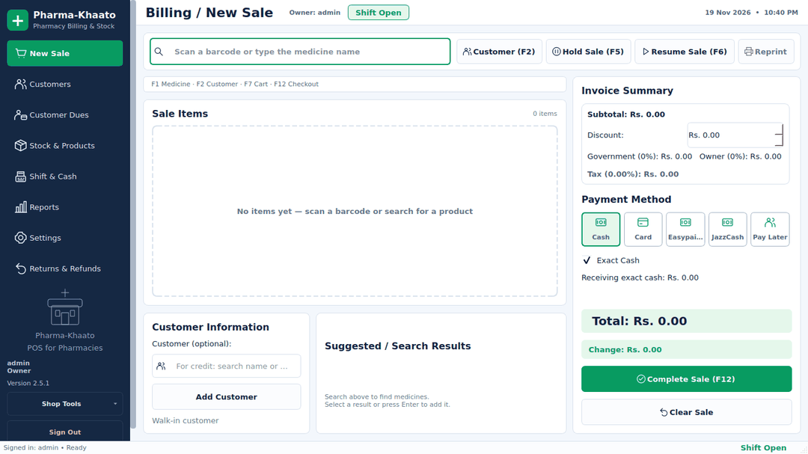

# Pharma Khaato

An offline pharmacy checkout for Windows and Linux. Scan medicines, print bills, track stock by expiry date, and see what customers owe.

  

**[Download for Windows](https://github.com/aazannoorkhuwaja/Pharma-Khaato/releases/download/v2.5.1/Pharma-Khaato-2.5.1-Setup-Windows-x64.exe)** · **[Download for Ubuntu](https://github.com/aazannoorkhuwaja/Pharma-Khaato/releases/download/v2.5.1/Pharma-Khaato-2.5.1-linux-amd64.deb)** · [All packages and checksums](https://github.com/aazannoorkhuwaja/Pharma-Khaato/releases/tag/v2.5.1)

48-second practice-shop tour · [View a still screenshot of checkout](docs/images/windows-practice-checkout.png)

## Install

- **Windows 10 or 11, x64.** Open the downloaded Setup file, then launch Pharma Khaato from Start. The 2.5.1 installer is unsigned.
- **Ubuntu, amd64.** From the download folder, run `sudo apt install ./Pharma-Khaato-2.5.1-linux-amd64.deb`, then launch `pharma-khaato`.

**Already using 2.5.0?** Verify your backup on a spare computer before upgrading. [Upgrade instructions](docs/UPGRADE_2_5_1.md)

## Start or open a pharmacy

| When you open the app | What to do |
| --- | --- |
| Start a new pharmacy | Launch **Pharma Khaato** on the new shop computer. On first launch, complete pharmacy setup and create the owner account. Enter only the tax and discount rates approved for your shop. |
| Returning after an upgrade or reinstall | Sign in with your existing shop account. Reinstalling preserves the shop’s records. |
| Starting fresh for training | Select **Create a fresh practice shop…** on the sign-in screen. On Windows you can also open **Pharma Khaato - Practice Shop** from Start. On Ubuntu run `pharma-khaato --practice --new` for a new practice shop. |

**Own more than one pharmacy?** Set up each location on its own shop computer. On a shared PC with the default installation, use a separate Windows or Ubuntu user account for each pharmacy. Launch the regular app from that account, create the pharmacy and its owner login, and keep its backups separately. Version 2.5.1 has no in-app branch switcher or combined reporting. Shared counters connect to one pharmacy.

**Owner access.** While you still know your password, enter your owner username on the sign-in screen and choose **Owner recovery code** to create a code. Store it offline. Staff who lose access should ask the shop administrator for a password reset.

## Make your first practice sale

1. In the practice shop, sign in and open a cash shift with Rs. 0.
2. Add a practice supplier and medicine, then receive 100 practice tablets priced at Rs. 5 each. Set tax and discounts to zero for this example.
3. In **New Sale**, sell three tablets to a walk-in customer and enter Rs. 100 cash received.

The bill should show **Rs. 15**, with **Rs. 85 change** and **97 tablets left**. [Step-by-step practice guide](docs/TRY_IT.md)

## At the pharmacy

| Task | What to do |
| --- | --- |
| Receive stock | Select the medicine in **Inventory**, choose **Receive More Stock**, and enter the supplier invoice, printed lot, expiry, unit, and quantity. Check alerts for the affected lot. |
| Make a sale | Scan or search in **New Sale**. Use **Walk-in** for an anonymous, fully paid sale. Review the discounts, tax, and final amount before confirming. |
| Take a partial payment | Select a customer. For a Rs. 6,000 bill paid with Rs. 4,000 cash, clear **Exact Cash**, enter Rs. 4,000, and confirm Rs. 2,000 as customer due. Record later payments in **Khatoo**. |
| Handle a return | In **Returns**, enter the sale number from the receipt or choose **Find my last sale** during the same sign-in. Review the amount and what should happen to the returned stock. |
| Close a shift | Count the physical drawer, review any difference, close the shift, and sign out before handing the counter to another employee. |

## Counters, backups, and troubleshooting

- **Shared counters.** One computer can bill offline. Multiple counters need the shop’s host computer and local network. Keep the SQLite database on the host. [Deployment guide](docs/DEPLOYMENT.md)
- **Backup failed.** Keep the existing shop and last verified backup. Before upgrading, create an off-device backup and verify it restores on a spare computer. If verification keeps failing, contact support with the app version and exact error message.
- **Receipt did not print.** Check whether the sale was saved. If it has a sale number, reprint the original receipt so the customer is charged only once.
- **Reporting a problem.** Include the operating system, app version, and steps that led to the issue. Redact customer details and keep passwords and recovery codes private. [Support](SUPPORT.md)

Use practice records while pharmacy and hardware acceptance is pending. [Site acceptance checklist](docs/PHARMACY_SITE_ACCEPTANCE.md)

## Guides and support

[Operator guide](docs/OPERATOR_QUICK_START.md) · [Documentation](docs/README.md) · [Support](SUPPORT.md) · [Contributing and tests](CONTRIBUTING.md)

Built by Azaan Noor Khuwaja with contributions from Atif Khan. [Credits](CREDITS.md) · [MIT license](LICENSE)
