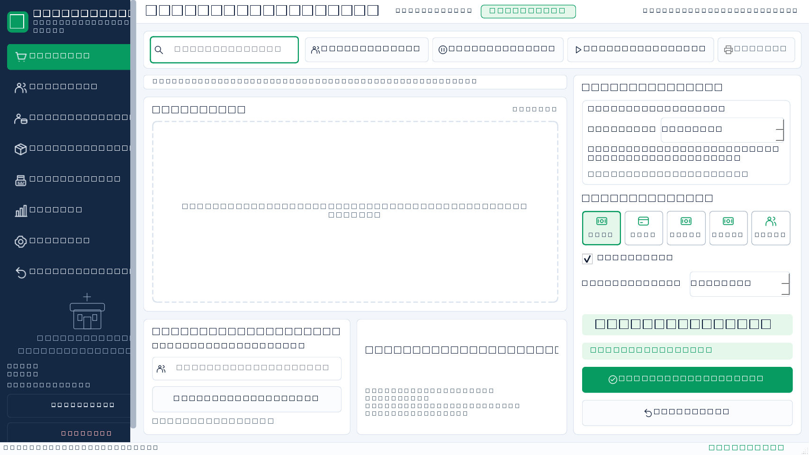

# Pharma Khaato

An offline pharmacy checkout for Windows and Linux. Scan medicines, print bills, track stock by expiry date, and see what customers owe.

  

**[Download for Windows](https://github.com/aazannoorkhuwaja/Pharma-Khaato/releases/download/v2.5.1/Pharma-Khaato-2.5.1-Setup-Windows-x64.exe)** · **[Download for Ubuntu](https://github.com/aazannoorkhuwaja/Pharma-Khaato/releases/download/v2.5.1/Pharma-Khaato-2.5.1-linux-amd64.deb)** · [All packages and checksums](https://github.com/aazannoorkhuwaja/Pharma-Khaato/releases/tag/v2.5.1)

## Install

- **Windows 10 or 11, x64.** Open the downloaded Setup file, then launch Pharma Khaato from Start. The 2.5.1 installer is unsigned.
- **Ubuntu, amd64.** From the download folder, run `sudo apt install ./Pharma-Khaato-2.5.1-linux-amd64.deb`, then launch `pharma-khaato`.

**Already using 2.5.0?** Verify your backup on a spare computer before upgrading. [Upgrade instructions](docs/UPGRADE_2_5_1.md)

## Make your first practice sale

1. Create your owner account and open a cash shift with Rs. 0.
2. Receive 100 practice tablets priced at Rs. 5 each. Set tax and discounts to zero for this example.
3. In **New Sale**, sell three tablets to a walk-in customer and enter Rs. 100 cash received.

The bill should show **Rs. 15**, with **Rs. 85 change** and **97 tablets left**. [Step-by-step practice guide](docs/TRY_IT.md)

## At the pharmacy

- **Checkout** — Scan or search for a medicine, take a payment, and record any customer due.
- **Stock** — Receive supplier deliveries and check quantities and expiry dates by batch.
- **Returns and cash** — Find the original bill for a return and reconcile the drawer at shift close.
- **Counter setup** — A single counter works offline. Shared counters use the shop computer and local network.

Use practice records while pharmacy and hardware acceptance is pending. [Site acceptance checklist](docs/PHARMACY_SITE_ACCEPTANCE.md)

## Guides and support

[Operator guide](docs/OPERATOR_QUICK_START.md) · [Documentation](docs/README.md) · [Support](SUPPORT.md) · [Contributing and tests](CONTRIBUTING.md)

Built by Azaan Noor Khuwaja with contributions from Atif Khan. [Credits](CREDITS.md) · [MIT license](LICENSE)
